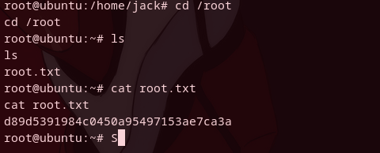

*	Difficult: `Eazy`
## WriteUp

1. Просканировал на открктые порты и версии сервисов. Cервисы которые мы имеем: `OpenSSH 7.2p2 | Ajp13 | Apache Tomcat 8.5.5`

   

2. Протокол ajp13 это бинарный сетевой протокол используемый Apache Tomcat для связи между фронтендом веб сервера и приложением (бэкэндом)
   Суть уязвимости в том, что она позволяет нам читать конфигурацию сервера без прохождения авторизации.
   Я нашел эксплоит на гитхабе и запустил.
   
   

3. Уязвимость работает, но доступ получить ни к одному из файлов я не смог.
4. При попытки ввести пароль нам говорят об ошибке авторизации и мы видим пример юзернейма и пароля `tomcat:s3cret`

   

5. Ввел эти данные и они подошли

   

6. Это моё первое взаимодействие с tomcat, но я сразу же нашел поле под загрузку архива веб приложения, и нашел информацию о том, что мы можем попытаться поместить в этот архив JSP файл с реверс шеллом. Суть в том, что tomcat автоматически регистирует новое приложение при загрузки его архива в webapps. 

   

7. Нашел jsp_shell на гитхабе, изменил под себя ip адрес и порт на свой, архивировал в war и загрузил.  После чего включил nc -lnvp 5555 и всё сработало. Немного затупил на этом шаге, так как был включен фаерволл и оболочка не пробивалась ко мне через него, а веб шелл слишком медленный, я хотел именно обратную оболочку

   

8. Сразу прочитал первый флаг, нужно поднять привилегии так как мы просто пользователь `tomcat`

   

9. В `crontab` увидел задачу `id.sg` из папки `jack` которая исполняется от имени рута, я имею права на изменения этого файла. Я изменил его так, чтобы каждую минуту он присылал реверсшелл рута на мой айпишник и порт. Закрыл и слушаю порт 5555.

  

10.  `cd /root` и читаю флаг

